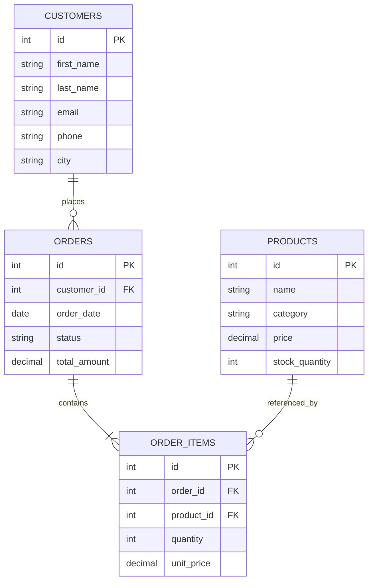

# MySQL Database Performance Optimization

A practical database engineering project focused on synthetic e-commerce data generation, data integrity, efficient SQL operations, and query performance optimization using Python and MySQL.

The project uses **311,000 synthetic records** to demonstrate relational database design, bulk insertion, transaction management, and set-based processing. Further work will explore execution plans, indexing, and query benchmarking.

## Project Objectives

- Design a relational database with primary and foreign keys.
- Generate large volumes of synthetic e-commerce data using Python.
- Insert records efficiently using `executemany()`.
- Maintain data integrity across related tables.
- Optimize database operations using set-based SQL instead of row-by-row processing.
- Analyze query execution plans and measure performance before and after indexing.
- Document reproducible performance results.

## Technologies

| Technology | Purpose |
| --- | --- |
| Python | Data generation, database operations, and performance measurement |
| MySQL | Relational database management and SQL processing |
| MySQL Connector/Python | Python-to-MySQL database connection |
| python-dotenv | Environment variable management |
| Git & GitHub | Version control and project documentation |

## Database Design



Each generated order contains at least one order item. Additional items are assigned randomly to existing orders. The `unit_price` stores the price per unit, and `total_amount` is calculated from the associated order items. The minimum of one item per order is a data-generation rule, not a foreign-key constraint.

### Dataset Size

| Table | Verified Record Count |
| --- | ---: |
| `customers` | 10,000 |
| `products` | 1,000 |
| `orders` | 100,000 |
| `order_items` | 200,000 |
| **Total** | **311,000** |

All data is generated for development and testing purposes. The generated dataset is not included in the repository.

## Project Structure

```text
mysql-database-performance-optimization/
├── main.py              # Data generation and order total updates
├── schema.sql           # MySQL database structure
├── requirements.txt     # Python dependencies
├── .env.example         # Environment configuration template
├── .gitignore           # Files excluded from version control
└── README.md            # Project documentation
```

## Installation and Setup

### 1. Prerequisites

- Python 3
- MySQL Server and MySQL command-line client
- Git (optional, for cloning and version control)

### 2. Install Python dependencies

From the project directory, run:

```bash
python -m pip install -r requirements.txt
```

### 3. Create and initialize the database

Log in to MySQL:

```bash
mysql -u root -p
```

Create a new database (or choose another name):

```sql
CREATE DATABASE performance_project;
USE performance_project;
SOURCE schema.sql;
```

Run the client from the project directory, or replace `schema.sql` with its full path. Use a fresh database for this setup; a schema exported with `mysqldump` may contain `DROP TABLE` statements.

### 4. Configure the environment

Copy `.env.example` to `.env` (PowerShell):

```powershell
Copy-Item .env.example .env
```

Set your local MySQL connection details:

```dotenv
DB_HOST=localhost
DB_PORT=3306
DB_USER=your_username
DB_PASSWORD=your_password
DB_NAME=performance_project
```

Never commit the `.env` file or real database credentials.

### 5. Generate the dataset

In `main.py`, enable the following function calls in this order for the initial run on an empty database:

```python
geterate_customer()
generate_products()
generate_orders()
generate_order_items()
updated_orders_items()
mydb.commit()
```

These are the function names used in the current implementation. The script currently enables the order-total update only, so the initial generation calls must be enabled manually.

Run the script:

```bash
python main.py
```

After the first successful run, disable the generation calls again to avoid duplicate data. Do not rerun the complete data generator against a populated database without intentionally resetting or recreating the test database.

## SQL Optimization: Order Total Calculation

The initial row-by-row approach retrieves order items for each order, calculates the total in Python, and issues an individual `UPDATE` statement for every order.

The optimized implementation performs the calculation directly in MySQL using aggregation and a joined update:

```sql
UPDATE orders
JOIN (
    SELECT
        order_id,
        SUM(quantity * unit_price) AS total_price
    FROM order_items
    GROUP BY order_id
) AS order_item
    ON orders.id = order_item.order_id
SET orders.total_amount = order_item.total_price;
```

This demonstrates **set-based processing**, reducing database round trips and eliminating Python loops from the order-total update operation.

| Metric | Row-by-row approach | Set-based approach |
| --- | ---: | ---: |
| SQL statements for 100,000 orders, excluding transaction commands | 200,001 (theoretical) | 1 |
| Measured execution time | Not yet benchmarked | 1.131 seconds |

The original implementation has not yet been timed, so no measured speedup is claimed.

## Performance Results

Initial local test results recorded on November 26, 2026:

| Operation | Records | Elapsed Time |
| --- | ---: | ---: |
| Order item generation and insertion | 200,000 | 4.924 seconds |
| Order total calculation and update | 100,000 | 1.131 seconds |

These are preliminary observations from a local test environment, not controlled multi-run benchmarks. The update timing includes the commit. Hardware, MySQL version, and detailed benchmark configuration will be documented in a future phase.

## Data Integrity Validation

| Validation Test | Status |
| --- | --- |
| Verify record counts for all four tables | Passed |
| Check for orders without order items | Passed |
| Check for orders referencing missing customers | Passed |
| Check for order items referencing missing orders | Pending verification |
| Check for order items referencing missing products | Pending verification |
| Check for non-positive quantities | Passed |
| Check for non-positive unit prices | Passed |
| Verify stored order totals against calculated totals | Pending |

## Project Roadmap

- [x] Design the relational database schema.
- [x] Implement database connectivity and transaction handling.
- [x] Generate customers, products, orders, and order items.
- [x] Calculate order totals using a single SQL update.
- [x] Record initial generation and update timings.
- [ ] Complete all data integrity checks.
- [ ] Develop advanced analytical SQL queries.
- [ ] Establish reproducible baseline performance benchmarks.
- [ ] Analyze query execution plans using `EXPLAIN`.
- [ ] Evaluate and implement appropriate indexes.
- [ ] Compare query performance before and after optimization.
- [ ] Publish the final performance report.

## Project Status

**Work in Progress.** The data generation and set-based update phases are complete. Data integrity validation and query performance optimization are ongoing.

## Author

Khaled Jallad

Database engineering portfolio project.
